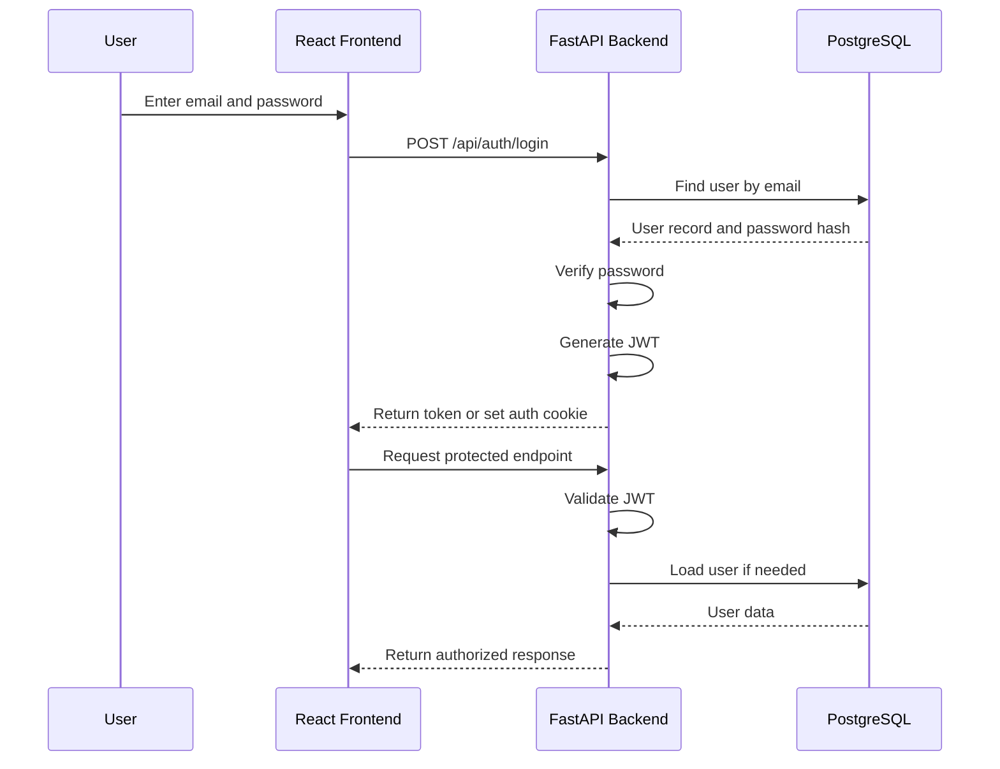

## 1. What is JWT?

**JWT stands for JSON Web Token.**

JWT is a compact, URL-safe format used to transmit information between two parties, such as a frontend and a backend.

In web development, JWT is commonly used for **authentication and authorization**.

For example, in your Papertrail Book Library:

1. A user registers with an email and password.
2. The user logs in.
3. The backend verifies the credentials.
4. The backend generates a JWT.
5. The frontend receives the token.
6. The frontend sends the token with requests to protected API endpoints.
7. The backend validates the token and identifies the user.

JWT helps the backend identify a user without necessarily storing a traditional server-side session for every login.

## 2. Why do we need JWT?

Imagine your Papertrail application has these endpoints:

| Endpoint | Access |
|---|---|
| `GET /api/books` | Public |
| `POST /api/books` | Logged-in users |
| `PUT /api/books/1` | Book owner |
| `DELETE /api/books/1` | Book owner |

The backend needs to know:

- Who is making the request?
- Is the user logged in?
- Is the user allowed to perform this action?

JWT can help answer these questions.

## 3. What does a JWT look like?

A JWT typically looks like this:

```text
xxxxx.yyyyy.zzzzz
```

It contains three parts separated by dots:

```text
HEADER.PAYLOAD.SIGNATURE
```

### Part 1: Header

The header contains information about the token type and signing algorithm.

```json
{
  "alg": "HS256",
  "typ": "JWT"
}
```

- `alg` — algorithm used to sign the token.
- `HS256` — HMAC with SHA-256.
- `typ` — indicates that the token is a JWT.

### Part 2: Payload

The payload contains claims, which are pieces of information about the user or token.

```json
{
  "sub": "42",
  "email": "user@example.com",
  "role": "user",
  "exp": 1790000000
}
```

Common claims:

| Claim | Meaning |
|---|---|
| `sub` | Subject, usually the user's ID |
| `exp` | Expiration time |
| `iat` | Time the token was issued |
| `iss` | Token issuer |
| `aud` | Intended audience |

**Important:** The JWT payload is encoded, not encrypted. Anyone who obtains the token can usually decode and read its payload. Never put passwords, password hashes, or sensitive personal information inside a JWT.

### Part 3: Signature

The signature is used to verify that the token has not been modified.

For an HS256 JWT, the signature is generated conceptually like this:

```python
signature = HMAC_SHA256(
    secret_key,
    encoded_header + "." + encoded_payload
)
```

If someone changes the payload, the signature will no longer match and the backend should reject the token.

## 4. How JWT authentication works



### Step-by-step explanation

1. **User logs in.** The frontend sends the user's credentials to the backend.
2. **Backend verifies the password.** It retrieves the user's record and checks the submitted password against the stored password hash.
3. **Backend generates a JWT.** If the credentials are correct, the backend creates a signed token.
4. **Frontend receives the token.** Depending on the design, the token may be returned in the response body or set in a secure cookie.
5. **Frontend requests protected data.** For a bearer-token approach, the token is sent in the `Authorization` header.
6. **Backend validates the token.** It checks the signature, expiration, and expected claims. It then applies authorization rules.

Example request:

```http
GET /api/books
Authorization: Bearer YOUR_JWT_TOKEN
```

## 5. JWT in Python

For learning purposes, we can use the `PyJWT` library.

### Install PyJWT

```bash
pip install PyJWT
```

### Generate a JWT

```python
import jwt
from datetime import datetime, timedelta, timezone

SECRET_KEY = "your-secret-key"
ALGORITHM = "HS256"


def create_access_token(user_id: int):
    payload = {
        "sub": str(user_id),
        "exp": datetime.now(timezone.utc) + timedelta(minutes=30),
        "iat": datetime.now(timezone.utc),
    }

    token = jwt.encode(
        payload,
        SECRET_KEY,
        algorithm=ALGORITHM,
    )

    return token


token = create_access_token(42)

print(token)
```

- `sub` stores the user's ID.
- `exp` sets the token expiration to 30 minutes.
- `iat` stores the time the token was issued.
- `jwt.encode()` generates the signed JWT.

### Verify a JWT

```python
import jwt

SECRET_KEY = "your-secret-key"
ALGORITHM = "HS256"


def verify_access_token(token: str):
    try:
        payload = jwt.decode(
            token,
            SECRET_KEY,
            algorithms=[ALGORITHM],
        )

        return payload

    except jwt.ExpiredSignatureError:
        print("Token has expired.")

    except jwt.InvalidTokenError:
        print("Invalid token.")

    return None
```

Usage:

```python
payload = verify_access_token(token)

if payload:
    user_id = payload["sub"]
    print("Authenticated user:", user_id)
```

**Note:** This is a learning example. In a real application, load the secret key from environment variables. The backend should also check whether the user still exists and whether their account is allowed to access the resource.

## 6. JWT vs Session Authentication

| Feature | JWT Authentication | Session Authentication |
|---|---|---|
| User identity | Usually stored in token claims | Stored in server-side session |
| Server-side session storage | Not necessarily required | Usually required |
| Validation | Verify token signature and claims | Look up session |
| Expiration | Token expiration claim | Session expiration |
| Revocation | Requires additional design | Often easier to revoke |
| Common use | APIs and distributed applications | Traditional web applications |

JWT is not automatically better than session authentication. Both can be secure when implemented properly.

## 7. Access Token vs Refresh Token

Many applications use two types of tokens.

### Access Token

An access token is used to access protected API endpoints.

Typical properties:

- Short expiration time.
- Sent with API requests.
- Used to identify the authenticated user.

Example lifetime: 15 minutes.

### Refresh Token

A refresh token is used to obtain a new access token without requiring the user to log in again.

Typical properties:

- Longer expiration time.
- Stored more carefully.
- Used only with a refresh endpoint.
- Should support revocation or rotation.

Example lifetime: 7 days.

These durations are examples, not universal rules.

## 8. JWT Security Best Practices

When implementing JWT authentication in Papertrail:

1. **Use a strong secret key.** Store it in `.env`, not directly in your Python code.
2. **Use HTTPS in production.** This protects tokens while they travel over the network.
3. **Set an expiration time.** Do not create tokens that remain valid indefinitely.
4. **Validate the signature and expiration.** Never trust a token just because it looks like a JWT.
5. **Do not store passwords in JWT payloads.**
6. **Use secure token storage.** For browser applications, secure, HttpOnly cookies can reduce exposure to JavaScript-based token theft. Cookie-based authentication also requires CSRF protection.
7. **Use authorization checks.** A valid token does not automatically mean the user can modify every book.
8. **Keep secrets out of GitHub.** Add `.env` to `.gitignore`.

A JWT proves that the token was issued by a trusted party and has not been modified. It does not, by itself, prove that the user is still authorized to perform every action.

## 9. JWT in Your Papertrail Project

Your Papertrail backend uses authentication dependencies such as:

```python
get_current_user
get_optional_current_user
```

These typically work like this:

| Dependency | Purpose |
|---|---|
| `get_current_user` | Requires a valid authenticated user |
| `get_optional_current_user` | Returns the user if authenticated, otherwise `None` |
| `require_csrf` | Checks CSRF protection for relevant requests |

For example:

```python
@app.post("/api/books")
def create_book(
    payload: BookInput,
    db: Session = Depends(get_db),
    user: User = Depends(get_current_user),
):
    ...
```

Here, `get_current_user` is responsible for identifying the authenticated user.

Your book creation route then uses:

```python
owner_id=user.id
```

This associates the new book with the authenticated user.

## 10. Quick Revision

- **JWT:** JSON Web Token.
- **Purpose:** Transmit signed claims and support authentication.
- **Structure:** Header + Payload + Signature.
- **Header:** Token type and signing algorithm.
- **Payload:** Claims such as user ID and expiration.
- **Signature:** Helps verify token integrity and authenticity.
- **Access token:** Used to access protected endpoints.
- **Refresh token:** Used to obtain a new access token.
- **JWT is encoded, not encrypted by default.**
- **A valid JWT does not automatically grant permission to access every resource.**