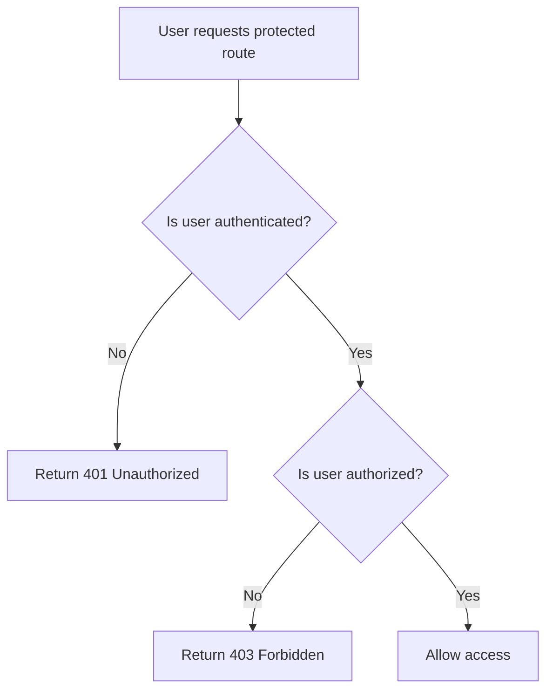

## 1. What Are Protected Routes?

A **protected route** is an API endpoint or frontend page that can only be accessed by users who meet specific authentication or authorization requirements.

For example, in the Papertrail Book Library:

| Route | Access |
|---|---|
| `/` | Public |
| `/books` | Public |
| `/login` | Public |
| `/profile` | Logged-in users |
| `POST /api/books` | Logged-in users |
| `DELETE /api/books/1` | Book owner |

Protected routes help ensure that only authorized users can access certain pages or perform specific actions.

## 2. Why Do We Need to Protect Routes?

Imagine your Papertrail application allows users to:

- Create book listings.
- Update their own books.
- Delete their own books.
- View their profile.
- Manage their account.

Without route protection, an unauthorized user might be able to access these features.

### Example

Suppose a user is not logged in but tries to send this request:

```http
DELETE /api/books/10
```

If the backend does not verify the user's identity and permissions, the user might be able to delete a book.

By protecting the route, the backend checks whether the user is authenticated and authorized before performing the operation.

## 3. Authentication vs Authorization

These are two important concepts in route protection.

### Authentication

Authentication answers:

**"Who are you?"**

For example:

- User enters an email and password.
- Backend verifies the credentials.
- Backend identifies the user.

JWT can be used to identify the authenticated user.

### Authorization

Authorization answers:

**"What are you allowed to do?"**

For example:

- User A owns Book 10.
- User B tries to delete Book 10.
- The backend checks the ownership.
- User B is denied access.

| Authentication | Authorization |
|---|---|
| Verifies user identity | Checks user permissions |
| Who are you? | What can you do? |
| Login and JWT validation | Roles and ownership checks |

**Important:** A user being logged in does not mean they can access every resource.

## 4. How Protected Routes Work



### Step-by-step process

1. User requests a protected endpoint.
2. Backend checks the authentication token or session.
3. If authentication fails, the backend returns `401 Unauthorized`.
4. If authentication succeeds, the backend checks permissions.
5. If permission is denied, the backend returns `403 Forbidden`.
6. If all checks pass, the backend processes the request.

## 5. Protecting Routes in FastAPI

In your Papertrail project, you use dependencies such as:

```python
get_current_user
```

This dependency checks whether the user is authenticated.

### Example: Protected API endpoint

```python
from fastapi import Depends
from .models import User
from .security import get_current_user


@app.get("/api/profile")
def get_profile(
    user: User = Depends(get_current_user),
):
    return {
        "id": user.id,
        "email": user.email,
    }
```

### Explanation

```python
user: User = Depends(get_current_user)
```

This tells FastAPI:

- Execute `get_current_user`.
- Verify the user's authentication.
- Provide the authenticated user to the endpoint.
- Reject the request if authentication fails.

The endpoint does not need to manually validate the JWT every time because the dependency handles that responsibility.

## 6. Protecting a Route Based on Ownership

In Papertrail, users should only be able to update or delete books they own.

Example:

```python
@app.delete("/api/books/{book_id}")
def delete_book(
    book_id: int,
    db: Session = Depends(get_db),
    user: User = Depends(get_current_user),
):
    book = db.get(Book, book_id)

    if book is None or book.owner_id != user.id:
        raise HTTPException(
            status_code=404,
            detail="Book not found.",
        )

    db.delete(book)
    db.commit()

    return {"message": "Book deleted successfully"}
```

Here:

```python
book.owner_id != user.id
```

checks whether the authenticated user owns the book.

If the book belongs to another user, the operation is rejected.

## 7. Protecting Frontend Routes in React

Frontend route protection improves the user experience by preventing unauthenticated users from viewing pages that require login.

For example, using React Router:

```jsx
import { Navigate, Outlet } from "react-router-dom";

function ProtectedRoute() {
  const isAuthenticated = Boolean(
    localStorage.getItem("token")
  );

  return isAuthenticated
    ? <Outlet />
    : <Navigate to="/login" replace />;
}

export default ProtectedRoute;
```

Usage:

```jsx
<Route element={<ProtectedRoute />}>
  <Route path="/profile" element={<Profile />} />
  <Route path="/dashboard" element={<Dashboard />} />
</Route>
```

If the user is not authenticated, they are redirected to the login page.

**Important:** Frontend route protection is not enough. Users can bypass frontend restrictions and send API requests directly using tools such as Postman. The backend must always enforce authentication and authorization.

## 8. HTTP Status Codes

| Status Code | Meaning |
|---|---|
| `200 OK` | Request completed successfully |
| `401 Unauthorized` | User is not authenticated or credentials are invalid |
| `403 Forbidden` | User is authenticated but does not have permission |
| `404 Not Found` | Requested resource does not exist or is intentionally hidden |

## 9. Quick Revision

- **Protected route:** A route that requires authentication or specific permissions.
- **Authentication:** Verifies the user's identity.
- **Authorization:** Determines what the user can access.
- **JWT:** Can be used to authenticate API requests.
- **401 Unauthorized:** Authentication is missing or invalid.
- **403 Forbidden:** User is authenticated but lacks permission.
- **Frontend protection:** Improves user experience.
- **Backend protection:** Enforces actual security.
- **Ownership checks:** Ensure users can modify only resources they are allowed to manage.
