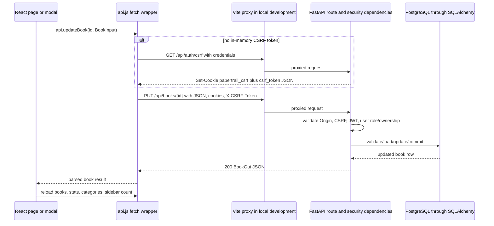

# Frontend–backend communication

Papertrail communicates from React to FastAPI with the browser’s native
`fetch` API. There is no Axios dependency or Axios source usage. Requests use
JSON when they have a body, include browser cookies, and use a CSRF header for
state-changing operations.

## Files that form the connection

| File | Verified responsibility |
| --- | --- |
| `frontend/src/services/api.js` | One fetch wrapper, CSRF bootstrap/retry, error parsing, and all frontend API methods. |
| `frontend/.env.example` | Contains `VITE_API_URL=`; it is intentionally empty for local relative API calls. |
| `frontend/vite.config.js` | Starts Vite at port 5173 and proxies `/api` to `http://127.0.0.1:8000` in development. |
| `backend/app/main.py` | FastAPI app, public/catalogue routes, and CORS middleware. |
| `backend/app/auth.py` | Auth, profile, password, and CSRF routes. |
| `backend/app/admin.py` | Admin users route. |
| `backend/app/schemas.py` | JSON validation and response serialization. |
| `backend/app/security.py` | Cookies, JWT resolution, CSRF/origin verification, and allowed origins. |

## Base URL and development proxy

The first line of `frontend/src/services/api.js` determines the client base:

```js
const API = (import.meta.env.VITE_API_URL || "").replace(/\/$/, "");
```

| Situation | `API` value | Browser request URL | What receives it |
| --- | --- | --- | --- |
| Local setup using the committed example | Empty string | Relative, for example `/api/books` | Vite receives it on port 5173 and proxies it. |
| A supplied `VITE_API_URL` | That origin, without one trailing slash | For example `https://api.example.test/api/books` | The browser calls the remote FastAPI origin directly. |

The exact remote deployment URL is not committed. There is no checked
`frontend/.env` file, only `.env.example`. The Vite proxy is exactly:

```js
server: {
  port: 5173,
  proxy: {
    "/api": "http://127.0.0.1:8000",
  },
},
```

The frontend API client does not call FastAPI’s `GET /` or `GET /health`
routes. Those routes exist for direct backend checks; they are included in the
endpoint inventory below.

## The shared request function

Every public method on `api` calls the same `request(path, options)` function.
Its core fetch call is:

```js
response = await fetch(`${API}${path}`, {
  ...options,
  method,
  credentials: "include",
  headers,
});
```

### What it sends

- `credentials: "include"` on every request, so the browser sends/accepts the
  HttpOnly access and CSRF cookies according to their cookie and cross-origin
  rules.
- `Content-Type: application/json` only when `options.body` is present.
- `X-CSRF-Token` on every method except `GET`, `HEAD`, and `OPTIONS`.
- JSON bodies produced with `JSON.stringify(...)`.
- No `Authorization` header and no bearer token. Authentication travels in the
  `papertrail_access` cookie.

The browser supplies `Origin` in the relevant cross-origin/unsafe request
contexts; client code does not forge it. The backend uses that header as part
of its CSRF validation.

### How it reads responses and errors

- A successful `204 No Content` becomes `null`.
- Any other successful response is parsed with `response.json()`.
- For failures, it reads response text, attempts `JSON.parse`, and turns a
  string `detail` into an `Error` message. For FastAPI validation errors where
  `detail` is an array, it uses the first item with a `msg` property.
- Network failures become: `Could not connect to the backend at ... Start the
  FastAPI server and try again.`
- Error objects receive a custom `error.status` field when the server returned
  an HTTP error status.

The exact fallback helper is:

```js
function errorMessage(body, fallback) {
  if (typeof body?.detail === "string") return body.detail;
  if (Array.isArray(body?.detail)) {
    const firstError = body.detail.find((item) => typeof item?.msg === "string");
    if (firstError) return firstError.msg;
  }
  return fallback;
}
```

## CSRF cookie/header workflow

The app requests a CSRF token from `GET /api/auth/csrf` when `AuthProvider`
starts and again before an unsafe request if no in-memory token exists.

```js
response = await fetch(`${API}/api/auth/csrf`, {
  credentials: "include",
});
const body = await response.json();
csrfToken = body.csrf_token;
```

FastAPI responds with JSON such as the following shape and sets the matching
`papertrail_csrf` cookie:

```json
{
  "csrf_token": "server-generated-random-value"
}
```

The illustration does not represent a usable token. The backend sets the
CSRF cookie as HttpOnly, `Path=/`, 12-hour `Max-Age`, `SameSite=lax` outside
production / `none` in production, and `Secure` in production. Because the
frontend cannot read the HttpOnly cookie, it uses the returned JSON value in
the header and the browser returns the cookie automatically.

For every `POST`, `PUT`, `PATCH`, or `DELETE`, FastAPI’s `require_csrf` checks:

```py
origin = request.headers.get("origin", "").rstrip("/")
if origin not in allowed_origins():
    raise HTTPException(status_code=status.HTTP_403_FORBIDDEN, detail="Invalid request origin.")
if not csrf_cookie or not csrf_header or not hmac.compare_digest(csrf_cookie, csrf_header):
    raise HTTPException(status_code=status.HTTP_403_FORBIDDEN, detail="CSRF validation failed.")
```

If the client receives the exact CSRF failure message, it clears the
in-memory token, fetches a fresh one, and retries the original request once.
It does not retry other errors automatically.

## Frontend API method inventory

This table lists every function exported in `api` and its matching backend
route. “Credentials” means browser cookies are included; “CSRF” means the
client adds `X-CSRF-Token` and the backend requires it.

| `api` method | HTTP URL | JSON request/body | Response on success | Cookies / CSRF |
| --- | --- | --- | --- | --- |
| `getCsrf()` | `GET /api/auth/csrf` | None | `{ "csrf_token": "..." }` | Credentials; no CSRF header. |
| `getBooks(params)` | `GET /api/books?search=&category=&availability=` | None; empty and `All` parameters are omitted | `BookOut[]` | Credentials optional; no CSRF. |
| `getBook(id)` | `GET /api/books/{id}` | None | `BookOut` | Credentials optional; no CSRF. |
| `getStats()` | `GET /api/stats` | None | `StatsOut` | Credentials; no CSRF. |
| `getCategories()` | `GET /api/categories` | None | `string[]` | Credentials; no CSRF. |
| `createBook(book)` | `POST /api/books` | `BookInput` | `BookOut`, `201` | Credentials, auth, CSRF. |
| `updateBook(id, book)` | `PUT /api/books/{id}` | `BookInput` | `BookOut` | Credentials, owner/admin auth, CSRF. |
| `deleteBook(id)` | `DELETE /api/books/{id}` | None | `null` from `204` | Credentials, owner/admin auth, CSRF. |
| `borrowBook(id)` | `POST /api/books/{id}/borrow` | None | `BookOut` | Credentials, owner/admin auth, CSRF. |
| `returnBook(id)` | `POST /api/books/{id}/return` | None | `BookOut` | Credentials, owner/admin auth, CSRF. |
| `signup(credentials)` | `POST /api/auth/signup` | `SignupInput` | `UserOut`, `201`; sets auth cookie | Credentials, CSRF; login not required. |
| `login(credentials)` | `POST /api/auth/login` | `LoginInput` | `UserOut`; sets auth cookie | Credentials, CSRF; login not required. |
| `getCurrentUser()` | `GET /api/auth/me` | None | `UserOut` | Valid auth cookie required; no CSRF. |
| `logout()` | `POST /api/auth/logout` | None | `null` from `204`; clears cookies | Valid auth cookie and CSRF. Clears client token afterward. |
| `updateProfile(profile)` | `PATCH /api/users/me` | `ProfileUpdate` | `UserOut` | Valid auth cookie and CSRF. |
| `changePassword(passwords)` | `POST /api/auth/change-password` | `ChangePasswordInput` | `{ "message": "Password changed. Please sign in again." }` | Valid auth cookie and CSRF. Clears client token afterward. |
| `forgotPassword(email)` | `POST /api/auth/forgot-password` | `{ "email": "..." }` | `PasswordResetResponse` | Credentials and CSRF; login not required. |
| `resetPassword(token, newPassword)` | `POST /api/auth/reset-password` | `{ "token": "...", "new_password": "..." }` | `{ "message": "Password reset successfully. Please sign in." }` | Credentials and CSRF; login not required. |
| `getAdminUsers()` | `GET /api/admin/users` | None | `UserOut[]` | Admin auth cookie required; no CSRF. |

### Implemented backend endpoints without a direct `api` method

| HTTP URL | Actual success response | Purpose |
| --- | --- | --- |
| `GET /` | `{ "message": "Papertrail API is running", "docs": "/docs" }` | API root. |
| `GET /health` | `{ "status": "ok" }` | Process health response. |

FastAPI also serves its generated `/docs` and `/openapi.json` interfaces by
default, but those are framework-generated documentation endpoints rather than
custom application route functions.

## Actual JSON shapes

### Book input and output

`BookModal` converts its controlled form before calling its parent:

```js
await onSave({
  ...form,
  title: form.title.trim(),
  author: form.author.trim(),
  category: form.category.trim() || "General",
  published_year: form.published_year === "" ? null : Number(form.published_year),
  total_copies: Number(form.total_copies),
});
```

The resulting `BookInput` shape is:

```json
{
  "title": "The Left Hand of Darkness",
  "author": "Ursula K. Le Guin",
  "category": "Science Fiction",
  "published_year": 1969,
  "description": "A novel about an envoy on the planet Gethen.",
  "total_copies": 3
}
```

`BookOut` adds server-managed and derived data:

```json
{
  "id": 12,
  "title": "The Left Hand of Darkness",
  "author": "Ursula K. Le Guin",
  "category": "Science Fiction",
  "published_year": 1969,
  "description": "A novel about an envoy on the planet Gethen.",
  "total_copies": 3,
  "borrowed_copies": 1,
  "available_copies": 2,
  "is_owner": true,
  "can_manage": true
}
```

`published_year` can be `null`. The last two fields depend on the optional
current user; they are false for an anonymous request. The numbers and text are
illustrative but the keys and types are the real schema.

### User, stats, and validation errors

`UserOut`, used by signup/login/me/profile/admin responses, is:

```json
{
  "id": 7,
  "full_name": "Avery Reader",
  "email": "avery@example.com",
  "role": "user",
  "created_at": "2025-01-15T10:30:00Z"
}
```

`GET /api/stats` returns:

```json
{
  "total_titles": 12,
  "total_copies": 20,
  "available_copies": 17,
  "borrowed_copies": 3
}
```

Most route errors are FastAPI JSON such as:

```json
{ "detail": "Authentication is required." }
```

Invalid schema data returns `422` with a `detail` array. The client chooses the
first item’s `msg`, for example the validation message about a weak password.

## CORS and cookie configuration

`backend/app/main.py` enables credentialed CORS:

```py
app.add_middleware(
    CORSMiddleware,
    allow_origins=sorted(allowed_origins()),
    allow_credentials=True,
    allow_methods=["GET", "POST", "PUT", "PATCH", "DELETE", "OPTIONS"],
    allow_headers=["Content-Type", "X-CSRF-Token"],
)
```

`allowed_origins()` reads the comma-separated backend `FRONTEND_URL` setting,
strips trailing slashes, and in non-production also adds
`http://localhost:5173` and `http://127.0.0.1:5173`. The inspected backend
environment file has this variable configured, but this document intentionally
does not publish its value. Because credentials are allowed, the server uses
specific origins rather than `*`.

The auth JWT cookie is named `papertrail_access`, is HttpOnly, has `Path=/api`,
expires after `ACCESS_TOKEN_EXPIRE_MINUTES`, is Secure in production, and uses
SameSite `lax` outside production / `none` in production. In production,
`SameSite=None` plus `Secure` means the frontend/API deployment must use HTTPS
and configure the exact browser origin correctly.

## Full request-response lifecycle

The following example traces an authenticated book update from the UI. The
same wrapper provides the transport behavior for other API calls.

1. The signed-in user submits `BookModal`. `Books.saveBook()` or
   `BookDetails.saveBook()` calls `api.updateBook(id, payload)`.
2. `api.updateBook` calls `request` with `PUT`, stringified JSON, credentials,
   `Content-Type`, and the in-memory CSRF value in `X-CSRF-Token`.
3. With an empty/stale in-memory token, `request` first or again calls
   `GET /api/auth/csrf`. The browser stores the matching CSRF cookie.
4. In local development, the browser asks Vite for `/api/books/{id}` and Vite
   proxies it to FastAPI at `127.0.0.1:8000`. With `VITE_API_URL`, the browser
   instead calls the specified API origin directly.
5. FastAPI CORS/CSRF code validates the origin and matching CSRF cookie/header.
   `get_current_user` decodes the JWT cookie, loads the active user, and checks
   the token version.
6. The update route validates the JSON as `BookInput`, loads the book, confirms
   owner/admin permission and copy-count rule, commits through SQLAlchemy, and
   serializes `BookOut`.
7. The fetch wrapper parses JSON. `Books` closes the modal, shows a toast, and
   reloads books, stats, categories, and the sidebar count. A failed request
   becomes an error alert instead.



For a remote `VITE_API_URL`, remove the Vite participant from this sequence:
the browser/API wrapper calls FastAPI directly, so the credentialed CORS and
cookie settings described above become essential.

## UI-level handling of authentication failures

For `401` responses, `request()` dispatches the custom browser event
`papertrail:unauthorized` except for login, signup, and `/api/auth/me` itself.
`AuthProvider` listens for the event and clears `user`. Route guards then
redirect attempts to view protected pages to `/login`; public catalogue pages
remain viewable. The individual pages still display their request error where
appropriate.

`AdminUsers` additionally handles a `403` from its own request by navigating
to `/unauthorized`. It does not rely only on the sidebar hiding the Users link.

## Implemented, partial, and missing

| Status | Verified finding |
| --- | --- |
| Implemented | Native fetch wrapper, relative/local proxy and configurable remote base URL, JSON serialization, response/error parsing, credentialed cookies, CSRF bootstrap/retry, CORS settings, all documented API methods, and page-level loading/error handling. |
| Partial / environment-dependent | The remote API URL is not committed; actual remote CORS, HTTPS, cookie delivery, PostgreSQL reachability, and SMTP delivery depend on deployment environment and were not exercised by repository inspection. |
| Missing | No Axios, no bearer-token/`Authorization` header path, no API response cache/query library, no request cancellation, no pagination parameters, and no automatic retry except one CSRF retry. |

## Summary

React calls FastAPI through `services/api.js`, either relatively through Vite’s
local `/api` proxy or through `VITE_API_URL`. It serializes request bodies as
JSON, sends browser cookies with every request, and uses a CSRF cookie/header
pair for writes. FastAPI validates CORS/CSRF/authentication, talks to the
database through SQLAlchemy, and returns Pydantic-serialized JSON that pages
use to update their local state.
