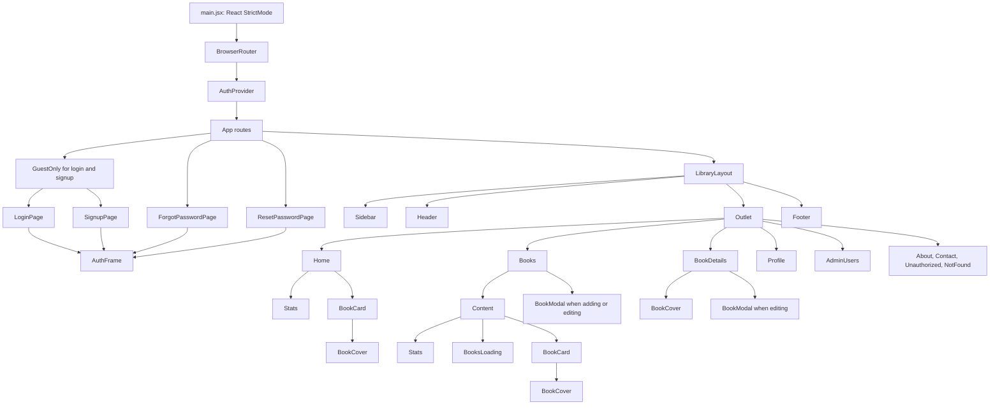

# Frontend component architecture

Papertrail’s frontend is a React 18 single-page application built with Vite,
React Router, Tailwind CSS, and Lucide icons. It has no `src/hooks/` directory
and no external state-management library. Shared authentication state is
implemented with React Context, while most page state stays in the page that
uses it.

## Source layout

All paths below are relative to the project root.

```text
frontend/
├── index.html                 # Vite HTML shell; contains #root
├── vite.config.js             # React plugin, port 5173, /api development proxy
├── .env.example               # VITE_API_URL= example
├── package.json               # dev/build/preview scripts and dependencies
└── src/
    ├── main.jsx               # React entry point and provider nesting
    ├── App.jsx                # Route table, guards, and shared library layout
    ├── index.css              # Tailwind directives and reusable CSS classes
    ├── constants.js           # CATEGORIES and EMPTY_BOOK
    ├── context/
    │   └── AuthContext.jsx    # AuthProvider and useAuth custom context hook
    ├── services/
    │   └── api.js             # Fetch client, CSRF, and API methods
    ├── components/
    │   ├── Header.jsx
    │   ├── Sidebar.jsx
    │   ├── Footer.jsx
    │   ├── Content.jsx
    │   ├── Stats.jsx
    │   ├── BookCard.jsx
    │   ├── BookCover.jsx
    │   ├── BookModal.jsx
    │   └── BooksLoading.jsx
    └── pages/
        ├── Home.jsx
        ├── Books.jsx
        ├── BookDetails.jsx
        ├── AuthPages.jsx
        ├── Profile.jsx
        ├── AdminUsers.jsx
        ├── About.jsx
        ├── Contact.jsx
        ├── Unauthorized.jsx
        └── NotFound.jsx
```

`frontend/src/index.css` uses the Tailwind directives and defines reusable
classes such as `.btn-primary`, `.btn-secondary`, `.icon-btn`, and
`.form-input`. `frontend/tailwind.config.js` scans `index.html` and all
`src/**/*.{js,ts,jsx,tsx}` files. There is no separate design-system, hooks,
utilities, Redux, or test folder in the frontend source tree.

## Entry point and provider order

`frontend/src/main.jsx` mounts React into the `#root` element from
`frontend/index.html`:

```jsx
createRoot(document.getElementById("root")).render(
  <React.StrictMode>
    <BrowserRouter>
      <AuthProvider>
        <App />
      </AuthProvider>
    </BrowserRouter>
  </React.StrictMode>,
);
```

This order matters:

1. `BrowserRouter` makes route location, navigation, URL parameters, and links
   available to the application.
2. `AuthProvider` initializes CSRF and session state before it renders children.
3. `App` selects the correct page and shared layout from the URL.

## Route map

`frontend/src/App.jsx` is the only route table. `LibraryLayout` is a parent
route with no `path`; its child pages render at its `<Outlet />`.

| URL | Page/component | Access behavior |
| --- | --- | --- |
| `/` | `Home` | Public, inside `LibraryLayout`. |
| `/books` | `Books` | Public catalogue, inside `LibraryLayout`. |
| `/books/:bookId` | `BookDetails` | Public detail page, inside `LibraryLayout`. |
| `/about` | `About` | Public, inside `LibraryLayout`. |
| `/contact` | `Contact` | Public, inside `LibraryLayout`. |
| `/profile` | `Profile` | Requires a current user through `RequireAuth`. |
| `/admin/users` | `AdminUsers` | Requires a current user whose `role` is `admin`. |
| `/unauthorized` | `Unauthorized` | Public explanatory page, inside `LibraryLayout`. |
| `*` | `NotFound` | Fallback inside `LibraryLayout`. |
| `/login` | `LoginPage` | `GuestOnly` redirects signed-in users away. |
| `/signup` | `SignupPage` | `GuestOnly` redirects signed-in users away. |
| `/forgot-password` | `ForgotPasswordPage` | Public and outside `LibraryLayout`. |
| `/reset-password` | `ResetPasswordPage` | Public and outside `LibraryLayout`. |

The four auth/recovery routes outside `LibraryLayout` use `AuthFrame`, so they
do not show the normal sidebar, header, or footer. A password-reset token comes
from the `token` query parameter, for example `/reset-password?token=...`.

## Route guards and access boundaries

`RequireAuth` uses the `user` returned by `useAuth()`:

```jsx
function RequireAuth({ children, role }) {
  const { user } = useAuth();
  const location = useLocation();
  if (!user) {
    return <Navigate to="/login" replace state={{ from: location }} />;
  }
  if (role && user.role !== role) {
    return <Navigate to="/unauthorized" replace />;
  }
  return children;
}
```

`GuestOnly` does the reverse for `/login` and `/signup`. A sign-in then uses the
saved `location.state.from.pathname`, when present, to return the user to the
page they requested.

These are UI navigation guards, not the only security layer. The backend still
checks the JWT, ownership, and admin role for every protected API operation.
Book pages are intentionally public, while `BookCard` and `BookDetails` use
the server-provided `can_manage` (falling back to `is_owner`) to decide whether
to show controls.

## Component hierarchy



The three `BookCover` nodes show separate rendered instances of the same
component, not three different source files.

## Shared layout and outlet data

`LibraryLayout` owns `totalTitles` for the sidebar badge. It loads
`api.getStats()` via `refreshLibraryStats`, then passes that function to nested
pages through React Router outlet context:

```jsx
<Sidebar totalTitles={totalTitles} />
<Header />
<Outlet context={{ refreshLibraryStats }} />
<Footer />
```

`Home`, `Books`, and `BookDetails` call `useOutletContext()` to refresh that
number after a relevant data load or mutation. The layout also displays the
authentication initialization error, if one happened, while keeping the
sidebar usable.

## Reusable components and real props

| Component | Used by | Inputs/behavior verified in source |
| --- | --- | --- |
| `Header` | `LibraryLayout` | Reads `useLocation()` for the breadcrumb label and `useAuth()` to show user name/profile link or sign-in link. |
| `Sidebar` | `LibraryLayout` | Receives `totalTitles`; reads auth context to append the Users nav item for an admin. |
| `Footer` | `LibraryLayout` | Static footer text. |
| `Stats` | `Home`, `Content` | Receives `stats` and displays `total_titles`, `available_copies`, `borrowed_copies`. |
| `BookCover` | `BookCard`, `BookDetails` | Receives `book` and optional `large=false`; creates a color/initials placeholder. It does not fetch or render uploaded cover images. |
| `BookCard` | `Home`, `Content` | Receives `book`, optional `onEdit`, `onDelete`, `onBorrow`, `onReturn`; uses `book.can_manage ?? book.is_owner` for controls. |
| `BookModal` | `Books`, `BookDetails` | Receives `book`, `onClose`, `onSave`; owns the editable form and calls `onSave` with normalized numbers/text. |
| `BooksLoading` | `Content` | No props; renders eight visual loading placeholders. |
| `Content` | `Books` | Receives data, filter values/setters, category options, mutation callbacks, and error/filter callbacks; selects loading, empty, or cards. |

`Content` has the broadest prop interface. Its actual input names are
`stats`, `books`, `loading`, `error`, `search`, `setSearch`, `category`,
`setCategory`, `availability`, `setAvailability`, `categoryOptions`, `onAdd`,
`onEdit`, `onDelete`, `onBorrow`, `onReturn`, `onDismissError`, and
`onClearFilters`.

## Page responsibilities

### Catalogue and home pages

- `Home` calls `api.getStats()` and `api.getBooks()` in `Promise.all`, displays
  the first three books as “recently added,” and calls `refreshLibraryStats()`.
  The server returns books in descending ID order, so slicing the first three
  makes this “recently added” behavior true for the present implementation.
- `Books` owns catalogue data, summary stats, `search`, `category`,
  `availability`, dynamic filter categories, a modal target, loading/error
  strings, and a toast. It waits 220 ms after a filter change before calling
  `api.getBooks`, `api.getStats`, and `api.getCategories` concurrently.
- `Books` sends form data to `api.createBook` or `api.updateBook`, confirms
  deletion with `window.confirm`, and calls the borrow/return methods. After a
  successful mutation, it reloads page data and refreshes the layout count.
- `BookDetails` reads `bookId` with `useParams`, fetches one book, and owns
  `modalOpen`, `working`, error, and toast state. Delete navigates to `/books`.

### Authentication pages and local auth helpers

`AuthPages.jsx` exports four pages and also defines four private reusable UI
helpers in the same file:

| Export/helper | Responsibility |
| --- | --- |
| `AuthFrame` | Shared branded page shell; accepts `eyebrow`, `title`, `description`, `children`, `footer`. |
| `PasswordField` | Controlled password input with its own visibility state; accepts `label`, `name`, `value`, `onChange`, `autoComplete`. |
| `PasswordRequirements` | Static 12–128 / upper-lower-number hint. |
| `FormError` | Renders a `role="alert"` only when it receives children. |
| `SubmitButton` | Accepts `loading`, `children`; disables and changes label to “Please wait…”. |
| `LoginPage` | Calls context `login`, then navigates to the original route or home. |
| `SignupPage` | Compares confirmation client-side, calls context `signup`, then navigates. |
| `ForgotPasswordPage` | Calls `api.forgotPassword`; only shows the reset link if the response has `reset_token`. |
| `ResetPasswordPage` | Reads the query token, compares confirmation, calls `api.resetPassword`, then redirects to login. |

### Profile, admin, and informational pages

- `Profile` assumes `RequireAuth` supplied a current `user`. It initializes
  name/email state from that user, calls `api.updateProfile`, then updates
  context through `setUser`. Its change-password success explicitly calls
  `setUser(null)` and redirects to login.
- `AdminUsers` fetches users in an effect. A server `403` redirects to
  `/unauthorized`; other failures render an error. It shows a table or an empty
  state.
- `About`, `Contact`, `Unauthorized`, and `NotFound` are static page components
  except for their links. `Contact` contains a `mailto:hello@papertrail.local`
  link; the repository does not verify it as a working support mailbox.

## State, hooks, and Context API

### Built-in React and Router hooks

| Hook/API | Verified uses |
| --- | --- |
| `useState` | Form fields, API data, filters, loading, errors, modal visibility, toast strings, and request-in-progress state. |
| `useEffect` | Initial data fetches, delayed catalogue load, toast timers, form reset when modal book changes, auth initialization, and unauthorized-event subscription. |
| `useCallback` | Stabilizes API loaders, auth operations, and `refreshLibraryStats` dependencies. |
| `useMemo` | Memoizes the `AuthProvider` context value. |
| `useRef` | Holds one shared auth-initialization promise, avoiding duplicate startup work under Strict Mode. |
| `useContext` | Powers `useAuth`. |
| Router hooks | `useLocation`, `useNavigate`, `useParams`, `useSearchParams`, and `useOutletContext` appear in the documented routes/pages. |

### Auth context state

`AuthProvider` exposes this value:

```jsx
{
  user,
  isAuthenticated: Boolean(user),
  loading,
  initializationError,
  login,
  signup,
  logout,
  refreshCurrentUser,
  setUser,
}
```

It starts in `loading=true` and renders an “Opening your Papertrail…” screen
instead of children. Its startup request sequence is `/api/auth/csrf`, then
`/api/auth/me`. It also listens for the custom `papertrail:unauthorized` event
from `services/api.js` and clears the user when an API request gets a relevant
`401` response.

There is one custom hook, `useAuth()`. It validates that it was called beneath
`AuthProvider`; otherwise it throws `useAuth must be used within an
AuthProvider.` There are no other custom hooks in the source tree.

## Loading, error, empty, and success states

| Location | Loading | Error | Empty/success |
| --- | --- | --- | --- |
| `AuthProvider` | Full-screen spinner before routes render | Stores non-401 startup failures in `initializationError` | Supplies user or null. |
| `Home` | Overview message/spinner | Alert with “Try again” | First-book prompt when no books. |
| `Books` / `Content` | `BooksLoading` skeleton | Dismissible alert | “No books found” with clear filters/add action; mutation toast. |
| `BookModal` | Disabled “Saving…” submit button | Modal-local alert | Closes only after a successful parent save. |
| `BookDetails` | Detail spinner | Retry/back panel when no book; in-page alert otherwise | Borrow/return/edit/delete buttons or a read-only notice; toast after actions. |
| Auth forms/Profile | Disabled submit button | `FormError`/inline alerts | Login/profile/reset messages and redirects after success. |
| `AdminUsers` | “Loading users…” | Alert or unauthorized redirect | “No user accounts found” table empty state. |

## Implemented, partial, and missing

| Status | Verified finding |
| --- | --- |
| Implemented | Client routing, context-based session state, auth route guards, public catalogue/detail views, owner/admin-aware controls, filters, modals, loading/error/empty states, profile, reset, and admin-user UI. |
| Partial | Categories returned by `/api/categories` are used in the `Books` filter, but `BookModal` uses only constant `CATEGORIES` for its select. A server-only custom category can be filtered but is not offered as an add/edit selection. The Contact page has static SQLite/support-email wording that is not verified by the backend configuration. |
| Missing | No frontend test suite, no shared `hooks/` folder beyond `useAuth`, no pagination UI, no uploadable book covers, and no individual-loan/borrower interface. |

## Summary

The frontend begins with router and auth providers, then uses `App` to divide
auth/recovery pages from the shared library layout. Pages own their local API
and form state; small presentational components receive data and callbacks as
props. `AuthContext` is the only global application state and the server’s
authorization flags determine whether management controls appear.
