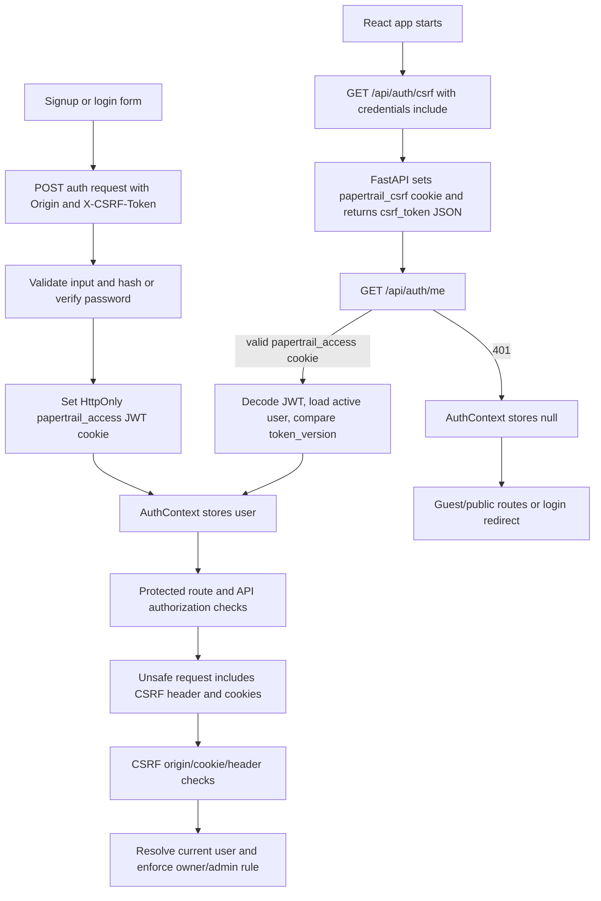

# Authentication flow

This guide describes the authentication code that is present in Papertrail. The
browser does **not** keep a JWT in local storage or send an `Authorization`
header. Instead, the backend puts a signed JWT in an HttpOnly cookie and the
browser returns that cookie automatically on API requests.

## Where the feature lives

| Responsibility | Verified file | What it does |
| --- | --- | --- |
| Auth, profile, and reset routes | `backend/app/auth.py` | Creates accounts, signs users in/out, updates profiles, and resets passwords. |
| Passwords, JWTs, cookies, CSRF, and access checks | `backend/app/security.py` | Hashes/verifies passwords and resolves the current user from the cookie. |
| Request/response validation | `backend/app/schemas.py` | Defines `SignupInput`, `LoginInput`, `UserOut`, password, and profile schemas. |
| Database records | `backend/app/models.py` | Defines `User` and `PasswordResetToken`. |
| API client | `frontend/src/services/api.js` | Uses `fetch`, cookies, and the CSRF token. |
| Shared frontend state | `frontend/src/context/AuthContext.jsx` | Loads the session and exposes `user`, `login`, `signup`, and `logout`. |
| Route guards and auth routes | `frontend/src/App.jsx` | Defines `RequireAuth`, `GuestOnly`, and the client routes. |
| Auth forms | `frontend/src/pages/AuthPages.jsx` | Implements sign-up, sign-in, forgot-password, and reset-password screens. |
| Account screen | `frontend/src/pages/Profile.jsx` | Implements profile changes, password changes, and sign-out. |

## Concepts used here

- **Password hash:** a one-way value stored instead of the original password.
- **JWT:** a signed token with claims about a session. In this app it is stored
  in the `papertrail_access` cookie, not returned in JSON.
- **HttpOnly cookie:** browser JavaScript cannot read it, which reduces the
  impact of a script injection stealing a token.
- **CSRF token:** a separate random value that the app sends in a header for
  state-changing requests. It proves the request came from the expected web
  application, alongside an origin check.

## Sign-up and sign-in, step by step

### 1. Initialize CSRF protection

`AuthProvider` runs once when the frontend starts. It calls
`api.getCsrf()` before asking for the current user. The client requests:

```http
GET /api/auth/csrf
```

The `issue_csrf_token` route in `backend/app/auth.py` calls
`set_csrf_cookie(response)` and returns the same random value as JSON:

```py
@router.get("/auth/csrf")
def issue_csrf_token(response: Response):
    return {"csrf_token": set_csrf_cookie(response)}
```

The frontend keeps that returned value in the module-local `csrfToken` variable
in `frontend/src/services/api.js`. It is not put in React state, local storage,
or a JavaScript-readable cookie.

### 2. Submit a sign-up request

`SignupPage` checks that the two password fields match, then calls
`signup({ full_name, email, password })`. The actual JSON shape is:

```json
{
  "full_name": "Avery Reader",
  "email": "avery@example.com",
  "password": "StrongPassword123"
}
```

The request is `POST /api/auth/signup`. `SignupInput` rejects extra fields,
normalizes email to lowercase, trims `full_name`, and requires a 12–128
character password with lowercase, uppercase, and numeric characters.

The route first checks the normalized email, hashes the password, creates a
`User`, then commits it:

```py
user = User(
    full_name=payload.full_name,
    email=payload.email,
    hashed_password=hash_password(payload.password),
)
db.add(user)
db.commit()
db.refresh(user)
set_auth_cookie(response, user)
```

Duplicate email handling returns `409` with
`{"detail":"An account with this email already exists."}`. A successful
response is `201` and contains a `UserOut` object, not a password or JWT:

```json
{
  "id": 7,
  "full_name": "Avery Reader",
  "email": "avery@example.com",
  "role": "user",
  "created_at": "2025-01-15T10:30:00Z"
}
```

The date and ID above are examples of the actual response structure, not data
read from a user account.

### 3. Submit a sign-in request

`LoginPage` calls `login({ email, password })`, which sends the same
`email`/`password` fields to `POST /api/auth/login`. The route selects a user
by normalized email and uses the stored hash:

```py
user = db.scalar(select(User).where(User.email == payload.email))
if user is None or not verify_password(payload.password, user.hashed_password) or not user.is_active:
    raise HTTPException(status_code=status.HTTP_401_UNAUTHORIZED, detail="Email or password is incorrect.")
set_auth_cookie(response, user)
return user
```

Unknown email, an invalid password, and an inactive account all return the
same `401` message. This avoids disclosing which part of the credentials was
wrong.

## Password hashing and verification

`backend/app/security.py` creates one `argon2.PasswordHasher` and calls it in
these functions:

```py
password_hasher = PasswordHasher()

def hash_password(password: str) -> str:
    return password_hasher.hash(password)

def verify_password(password: str, hashed_password: str) -> bool:
    try:
        return password_hasher.verify(hashed_password, password)
    except (VerifyMismatchError, VerificationError, InvalidHashError):
        return False
```

Only `users.hashed_password` is persisted. `UserOut` deliberately has no
password or hash field, so successful auth, profile, and admin-user responses
do not expose it.

## JWT creation, storage, and validation

### Creation

After a successful sign-up or sign-in, `set_auth_cookie()` calls
`create_access_token(user)`. Its HS256 JWT claims are:

| Claim | Value | Why it is used |
| --- | --- | --- |
| `sub` | User ID as a string | Identifies the account. |
| `iat` | Current UTC time | Issued-at time. |
| `exp` | `iat` plus `ACCESS_TOKEN_EXPIRE_MINUTES` | Expiration. The default is 30 minutes. |
| `jti` | Random URL-safe ID | Required during decoding, but there is no database-backed per-token revocation list. |
| `tv` | `users.token_version` | Invalidates older tokens after a password change or reset. |

The relevant implementation is:

```py
return jwt.encode(
    {
        "sub": str(user.id),
        "iat": now,
        "exp": now + timedelta(minutes=ACCESS_TOKEN_EXPIRE_MINUTES),
        "jti": secrets.token_urlsafe(16),
        "tv": user.token_version,
    },
    JWT_SECRET_KEY,
    algorithm=JWT_ALGORITHM,
)
```

The app fails at import time unless `JWT_SECRET_KEY` has at least 32 UTF-8
bytes, the algorithm is exactly `HS256`, and the expiration is positive.

### Storage and transmission

The response sets `papertrail_access` with these verified attributes:

| Attribute | Value |
| --- | --- |
| Value | The generated JWT |
| `HttpOnly` | `true` |
| `Path` | `/api` |
| `Max-Age` | `ACCESS_TOKEN_EXPIRE_MINUTES * 60` |
| `Secure` | `true` only when `ENVIRONMENT == "production"` |
| `SameSite` | `"lax"` outside production; `"none"` in production |

`frontend/src/services/api.js` uses native `fetch` with
`credentials: "include"` on every request. That lets the browser send the
cookie. There is no `Authorization: Bearer ...` code and no frontend code that
can read the HttpOnly JWT.

### Validation and current-user lookup

Protected routes depend on `get_current_user`. It obtains
`papertrail_access` from the request cookie, decodes it with the configured
HS256 key, requires all five claims, loads the `User` by `sub`, and checks that
the user is active and that the stored `token_version` still matches `tv`.

```py
claims = jwt.decode(
    token,
    JWT_SECRET_KEY,
    algorithms=[JWT_ALGORITHM],
    options={"require": ["sub", "exp", "iat", "jti", "tv"]},
)
user = db.get(User, user_id)
if user is None or not user.is_active or user.token_version != token_version:
    raise credentials_error
```

`GET /api/auth/me` returns that resolved `UserOut`. On app startup,
`AuthProvider` calls it after requesting CSRF and stores the result in its
`user` state. A `401` becomes `user = null`; other startup errors are displayed
as `initializationError`.

## Protected API operations and authorization

Authentication is the question “who is this?”; authorization is the question
“may this account do this?”. The backend enforces both—frontend hiding is not
the authority check.

| API operation | Authentication | Authorization after authentication |
| --- | --- | --- |
| `GET /api/auth/me` | Required | Any valid active user. |
| `PATCH /api/users/me` | Required | Updates only the resolved user. |
| `POST /api/auth/change-password` | Required | Changes only the resolved user. |
| `POST /api/auth/logout` | Required | Clears that browser session. |
| `POST /api/books` | Required | New book receives `owner_id=user.id`. |
| `PUT`, `DELETE`, `POST /borrow`, `POST /return` on `/api/books/{book_id}` | Required | Book owner or `role == "admin"`; otherwise the route returns `404`. |
| `GET /api/admin/users` | Required | `get_admin_user` requires `role == "admin"`; otherwise `403`. |
| Book reads, stats, categories, root, health | Not required | Reads are public. A valid optional session only changes book flags. |

Book read routes use `get_optional_current_user`. `book_response()` then sets
`is_owner` when the book’s `owner_id` matches the user, and `can_manage` for an
owner **or** administrator. These two fields are calculated response fields;
they are not database columns.

Public signup cannot choose an admin role: `SignupInput` forbids extra input
fields, and the model defaults `role` to `user`. There is no public role-change
endpoint.

## Frontend route protection

`frontend/src/App.jsx` contains two local guard components:

```jsx
function RequireAuth({ children, role }) {
  const { user } = useAuth();
  const location = useLocation();
  if (!user) return <Navigate to="/login" replace state={{ from: location }} />;
  if (role && user.role !== role) return <Navigate to="/unauthorized" replace />;
  return children;
}
```

- `/profile` is wrapped in `RequireAuth`.
- `/admin/users` is wrapped in `RequireAuth role="admin"`.
- `/login` and `/signup` are wrapped by `GuestOnly`, which redirects an
  already-signed-in user to the saved destination or `/`.
- `/books` and `/books/:bookId` are intentionally public. The UI shows
  book-management controls only when the server returned `can_manage` (or its
  older fallback `is_owner`), while the API repeats the authorization check.

The root `AuthProvider` renders a loading screen before it renders the routes,
so the guards do not make their first decision until the initial `/me` request
has completed.

## Logout, password changes, and token invalidation

`POST /api/auth/logout` requires a valid session plus CSRF protection, then
calls `clear_auth_cookies(response)`. It clears both the access cookie at
`/api` and the CSRF cookie at `/`. The frontend’s `api.logout()` also clears its
in-memory `csrfToken`, and `AuthContext.logout()` sets `user` to `null`.

Changing or resetting a password does more than clear the current cookies. The
routes hash the new password and increment `user.token_version`. Previously
issued JWTs contain the old `tv` claim and fail `get_current_user` thereafter.
The Profile page redirects to sign-in after a successful change.

## CSRF and CORS protections

Every `POST`, `PUT`, `PATCH`, and `DELETE` route listed above has
`Depends(require_csrf)`. It checks both:

1. The request `Origin` must be in `allowed_origins()`.
2. The `papertrail_csrf` cookie and `X-CSRF-Token` header must be present and
   equal, using `hmac.compare_digest`.

The API client automatically gets a token before an unsafe request and adds:

```js
headers["X-CSRF-Token"] = csrfToken || (await fetchCsrfToken());
```

If an unsafe request receives exactly `403` with
`"CSRF validation failed."`, it obtains one fresh CSRF token and retries once.
`backend/app/main.py` configures credentialed CORS with the specific configured
origins, all common methods, and only `Content-Type` and `X-CSRF-Token` request
headers. There is no wildcard origin configuration.

## Password reset

Password reset is implemented in both frontend and backend.

1. `ForgotPasswordPage` posts `{ "email": "..." }` to
   `POST /api/auth/forgot-password`.
2. For an active known user, the backend invalidates previous unused reset
   records, creates a `secrets.token_urlsafe(32)` token, stores only its SHA-256
   hash in `password_reset_tokens`, and gives it a 30-minute expiration.
3. In `development`, the successful response includes `reset_token` so the UI
   can link to `/reset-password?token=...`. Outside development, it returns
   `reset_token: null` and attempts email delivery through the configured SMTP
   settings.
4. `ResetPasswordPage` posts `{ "token": "...", "new_password": "..." }`
   to `POST /api/auth/reset-password`.
5. The backend locks the matching unused record, rejects an invalid/expired
   token, hashes the new password, increments `token_version`, marks the used
   token and other unused tokens as used, commits, and clears cookies.

The normal success message is the same for known and unknown email addresses:
`If an account exists for that email, password reset instructions will be sent.`
That limits account enumeration.

**Operational caveat:** SMTP variables are present in `backend/.env`, and the
email-sending code exists, but this repository inspection did not send mail or
verify a reachable SMTP server. Production email delivery is therefore
configured in code but not verified as working here. If SMTP is absent outside
development, the forgot-password endpoint returns `503` before looking up the
account.

## End-to-end flow



## Implemented, partial, and missing

| Status | Verified finding |
| --- | --- |
| Implemented | Sign-up, sign-in, Argon2 hashing, HttpOnly JWT cookie sessions, `/me`, logout, owner/admin authorization, CSRF/origin checks, profile updates, password change, and password reset routes/UI. |
| Partial / operationally unverified | SMTP reset delivery is coded but was not exercised; development intentionally returns a reset token for an existing active account. |
| Missing | No refresh-token endpoint, email verification, public role-management endpoint, or database-backed per-`jti` logout/revocation list. The `jti` claim is required during decode but is not otherwise queried. |

## Summary

Papertrail uses a short-lived, HS256 JWT inside an HttpOnly cookie. FastAPI
validates the JWT and the current user record on every protected request; the
React context mirrors the resulting user for UI and routes. CSRF uses a
double-submit cookie/header comparison plus allowed-origin validation, and the
backend—not just the frontend—enforces owner and administrator permissions.
