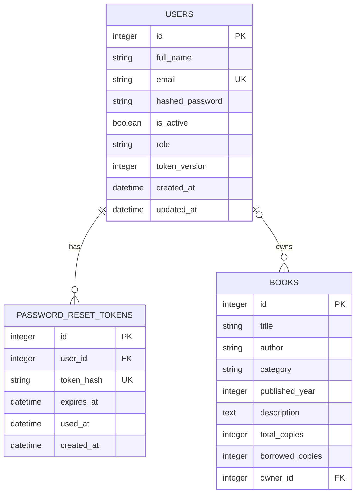

# Database structure

This document separates the configured database from a local artifact found in
the repository. It then documents the schema defined by the SQLAlchemy models
and PostgreSQL migrations.

## What database is actually configured?

`backend/app/database.py` loads environment values with `load_dotenv()` and
requires `DATABASE_URL`:

```py
DATABASE_URL = os.getenv("DATABASE_URL")

if not DATABASE_URL:
    raise RuntimeError("DATABASE_URL is missing from .env")

engine = create_engine(DATABASE_URL)
```

The checked local `backend/.env` has a `DATABASE_URL` whose scheme is
`postgresql+psycopg`. That matches the `psycopg[binary]` dependency in
`backend/requirements.txt`, the PostgreSQL-only migration script in
`backend/scripts/apply_migration.py`, and the project README. The configured
target is therefore **PostgreSQL through SQLAlchemy 2 and Psycopg 3**.

The repository also has `backend/papertrail.db`. It is ignored by Git and its
inspected SQLite schema contains only a legacy `books` table without
`owner_id`, `users`, or `password_reset_tokens`. It is not the database selected
by the checked `.env`, so it must not be mistaken for the current application
schema. `frontend/src/pages/Contact.jsx` says “local SQLite database”; that is a
static UI sentence inconsistent with the configured backend and does not prove
runtime storage technology.

**Verification boundary:** this inspection did not connect to the configured
PostgreSQL server or expose its credentials. The tables below are the schema
the checked SQLAlchemy source declares and the checked migrations build. The
live PostgreSQL server’s migration state and rows are not verifiable from the
repository alone.

## SQLAlchemy setup and lifecycle

`backend/app/database.py` makes a SQLAlchemy engine, a session factory, and a
declarative base. `get_db()` provides one `Session` to a request and closes it
afterward:

```py
SessionLocal = sessionmaker(
    bind=engine,
    autoflush=False,
    autocommit=False,
)

def get_db():
    db = SessionLocal()
    try:
        yield db
    finally:
        db.close()
```

At FastAPI startup, `backend/app/main.py` runs
`Base.metadata.create_all(bind=engine)`, creating tables absent from the model
metadata. Existing PostgreSQL installations also have two additive SQL
migrations:

- `backend/migrations/001_auth_and_book_ownership.sql` creates `users` and
  `password_reset_tokens`, and adds `books.owner_id` with its foreign key.
- `backend/migrations/002_add_user_roles.sql` adds `users.role` and its role
  check constraint.

`backend/scripts/apply_migration.py` accepts only PostgreSQL URLs and executes
the numbered `.sql` files in order. It is not an ORM migration framework and it
does not maintain a migration-history table.

## Entity relationship diagram

The foreign keys exist at database level. The ORM classes do **not** declare
SQLAlchemy `relationship()` attributes such as `User.books` or `Book.owner`.
The relationships in the diagram are therefore relational constraints, not
navigable ORM properties.



`BOOKS.owner_id` is nullable, so a book can be unowned. This preserves older
catalogue records. `ondelete="SET NULL"` means deleting a user keeps their
books but clears the owner ID. In contrast, deleting a user cascades to that
user’s password-reset token records.

## Tables and columns

### `users`

Model: `backend/app/models.py` → `class User(Base)`.

| Column | PostgreSQL-oriented type in source/migration | Null? | Key/default/constraint | Purpose |
| --- | --- | --- | --- | --- |
| `id` | `INTEGER` | No | Primary key; indexed; model lets SQLAlchemy generate it | Account identifier. |
| `full_name` | `VARCHAR(120)` | No | — | Displayed account name. |
| `email` | `VARCHAR(320)` | No | Unique and indexed | Normalized sign-in address. |
| `hashed_password` | `VARCHAR(255)` | No | — | Argon2 hash, never a plaintext password. |
| `is_active` | `BOOLEAN` | No | Default `true` | Inactive accounts cannot sign in or resolve from JWT. |
| `role` | `VARCHAR(16)` | No | Default/server default `user`; check `role IN ('user', 'admin')` | Authorization role. |
| `token_version` | `INTEGER` | No | Default `0` | Changes invalidate JWTs made under an older version. |
| `created_at` | `TIMESTAMP WITH TIME ZONE` (`DateTime(timezone=True)`) | No | Python default `utc_now` | Account creation time. |
| `updated_at` | `TIMESTAMP WITH TIME ZONE` | No | Python default `utc_now`; Python `onupdate=utc_now` | Last SQLAlchemy-managed update time. |

The migration creates an identity primary key and explicit email index. The
model additionally marks `id` indexed. Whether a separately named primary-key
index exists is PostgreSQL implementation detail; the logical primary key is
always indexed by the database.

### `password_reset_tokens`

Model: `backend/app/models.py` → `class PasswordResetToken(Base)`.

| Column | Type | Null? | Key/default/constraint | Purpose |
| --- | --- | --- | --- | --- |
| `id` | `INTEGER` | No | Primary key | Reset-record identifier. |
| `user_id` | `INTEGER` | No | Indexed foreign key → `users.id`, `ON DELETE CASCADE` | Account whose password can be reset. |
| `token_hash` | `VARCHAR(64)` | No | Unique and indexed | SHA-256 hex digest of the raw reset token. |
| `expires_at` | `TIMESTAMP WITH TIME ZONE` | No | — | 30-minute expiration set by the route. |
| `used_at` | `TIMESTAMP WITH TIME ZONE` | Yes | — | Non-null means the token cannot be reused. |
| `created_at` | `TIMESTAMP WITH TIME ZONE` | No | Python default `utc_now` | Reset record creation time. |

There is no raw-token column. The raw token exists only long enough to return
in development or to construct an email link, while its SHA-256 hash is stored.

### `books`

Model: `backend/app/models.py` → `class Book(Base)`.

| Column | Type | Null? | Key/default/constraint | Purpose |
| --- | --- | --- | --- | --- |
| `id` | `INTEGER` | No | Primary key; indexed | Book identifier. |
| `title` | `VARCHAR(180)` | No | Indexed | Book title. |
| `author` | `VARCHAR(120)` | No | Indexed | Author name. |
| `category` | `VARCHAR(80)` | No | Default `General`; indexed | Category label. |
| `published_year` | `INTEGER` | Yes | — | Optional publication year. |
| `description` | `TEXT` | No | Default empty string | Optional description stored as a string. |
| `total_copies` | `INTEGER` | No | Default `1` | Number of copies held. |
| `borrowed_copies` | `INTEGER` | No | Default `0` | Number currently marked borrowed. |
| `owner_id` | `INTEGER` | Yes | Indexed foreign key → `users.id`, `ON DELETE SET NULL` | Account allowed to manage the book; null for a legacy/unowned record. |

`available_copies` is **not a column**. It is the model property below and is
serialized by `BookOut`:

```py
@property
def available_copies(self) -> int:
    return self.total_copies - self.borrowed_copies
```

Likewise, `BookOut.is_owner` and `BookOut.can_manage` are API response fields
computed in `book_response()`; they are not persisted.

## Constraints and application validation

There are two layers of rules:

1. **Database/model structure:** non-nullability, email/token uniqueness, the
   two foreign keys, and the `users.role` check constraint are represented by
   the model and migrations.
2. **Pydantic request validation:** `backend/app/schemas.py` validates incoming
   API data before the route writes it.

For books, `BookInput` requires nonblank trimmed `title`, `author`, and
`category`; limits their lengths to 180, 120, and 80; allows years 1000–2100;
limits descriptions to 3000 characters; and requires `total_copies` from
1–10,000. `borrowed_copies` is not client input.

For accounts, `SignupInput` and the new-password schemas require an email and
a 12–128-character password with uppercase, lowercase, and numeric characters.
`ProfileUpdate` accepts only `full_name` and/or `email`, rejects unknown fields,
and rejects an empty update.

**Important limitation:** the database model and migrations contain no checked
constraint such as `borrowed_copies >= 0`, `borrowed_copies <= total_copies`, or
the Pydantic year/copy ranges. The update, borrow, and return route logic
enforces the usual API path, but direct SQL or concurrent edge cases are not
guarded by a database check constraint.

## Pydantic schemas: database data versus API data

| Schema | Used by | Key fields |
| --- | --- | --- |
| `BookInput` | Create and full update | Editable book fields only; no `id`, owner, or borrowed count. |
| `BookOut` | Book reads and mutations | Book data plus derived `available_copies`, `is_owner`, `can_manage`. |
| `StatsOut` | `/api/stats` | Four library-wide integer totals. |
| `SignupInput`, `LoginInput` | Auth requests | Account credentials; signup forbids extra fields. |
| `UserOut` | Signup, login, current user, profile, admin list | `id`, name, email, role, creation date only. |
| `ProfileUpdate` | `PATCH /api/users/me` | Optional `full_name` and `email`, at least one required. |
| `ChangePasswordInput` | Password change | Current and new passwords. |
| `ForgotPasswordInput`, `ResetPasswordInput`, `PasswordResetResponse` | Reset flow | Reset email, token/new password, and generic response. |

Schemas are not database tables. They are validation and serialization
boundaries between JSON and the SQLAlchemy models.

## Actual CRUD and query behavior

### Book reads

- `GET /api/books` starts with `select(Book)`. It optionally applies
  `Book.title.ilike("%term%")` and exact `Book.category == category`, orders
  by descending ID, then applies `Available`/`Borrowed` filtering in Python
  after fetching the rows.
- `GET /api/books/{book_id}` uses `db.get(Book, book_id)`.
- `GET /api/stats` fetches all books with `db.scalars(select(Book)).all()` and
  sums copy counts in Python.
- `GET /api/categories` runs
  `select(Book.category).distinct().order_by(Book.category)` and unions the
  stored values with a fixed default-category list.

The title-only search is confirmed by `backend/tests/test_book_search.py`;
author and description are not search fields.

### Book writes

| Operation | Verified data work |
| --- | --- |
| Create | Constructs `Book(**payload.model_dump(), owner_id=user.id)`, then `add`, `commit`, and `refresh`. |
| Update | Loads with `db.get`; allows owner/admin; refuses a new `total_copies` below current `borrowed_copies`; writes every `BookInput` field with `setattr`, then commits/refreshes. |
| Delete | Loads, checks owner/admin, then `db.delete(book)` and commits. |
| Borrow | Loads/checks, refuses when `available_copies < 1`, increments `borrowed_copies`, commits/refreshes. |
| Return | Loads/checks, refuses when `borrowed_copies < 1`, decrements it, commits/refreshes. |

### Account and reset writes

- Signup checks email with `select(User.id).where(User.email == payload.email)`,
  adds a `User`, and handles a commit-time `IntegrityError` as `409`.
- Login selects `User` by email. `/auth/me` and JWT validation use
  `db.get(User, user_id)`.
- Profile update checks another user with the requested email using
  `select(User.id).where(User.email == updates["email"], User.id != user.id)`
  before setting changed attributes and committing.
- Change/reset password updates `hashed_password` and increments
  `token_version`.
- Forgot-password invalidates old unused records with SQLAlchemy `update`, adds
  one `PasswordResetToken`, and commits.
- Reset-password selects an unused matching hash with `with_for_update()`,
  marks it used, marks other unused reset records for that user used, and
  commits.
- `GET /api/admin/users` returns
  `db.scalars(select(User).order_by(User.id)).all()` to an admin only.

## Implemented, partial, and missing

| Status | Verified finding |
| --- | --- |
| Implemented | PostgreSQL configuration, SQLAlchemy engine/session setup, three model tables, foreign keys, unique fields, startup `create_all`, PostgreSQL migration scripts, Pydantic validation, and CRUD routes. |
| Partial / unverifiable | The repository proves the intended PostgreSQL schema but not the configured server’s current migration state or records. The checked SQLite file is legacy/incomplete and not authoritative. |
| Missing | No `relationship()` mappings, loan/borrower/due-date/history table, pagination query, migration history tracking, or database check constraints for copy-count invariants. |

## Summary

Papertrail is configured to use PostgreSQL via SQLAlchemy and Psycopg. Its
schema has users, password-reset tokens, and books; users own zero or more
books and have zero or more reset tokens. The API uses Pydantic to validate
JSON and SQLAlchemy sessions to read/write records, while several business
rules remain application-level rather than database constraints.
